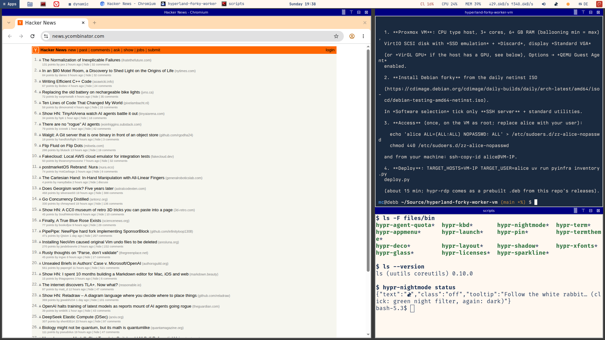
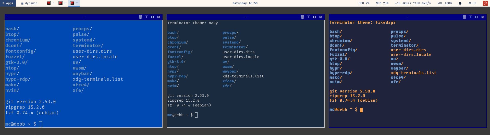
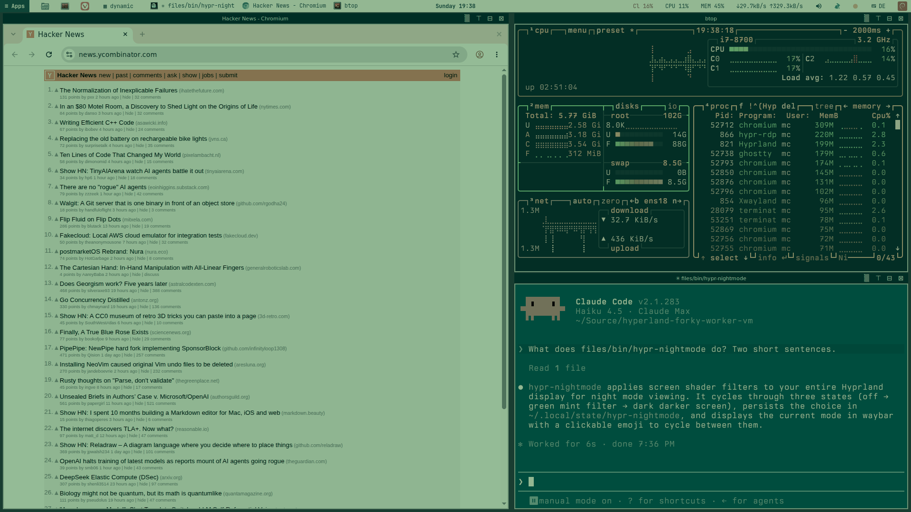
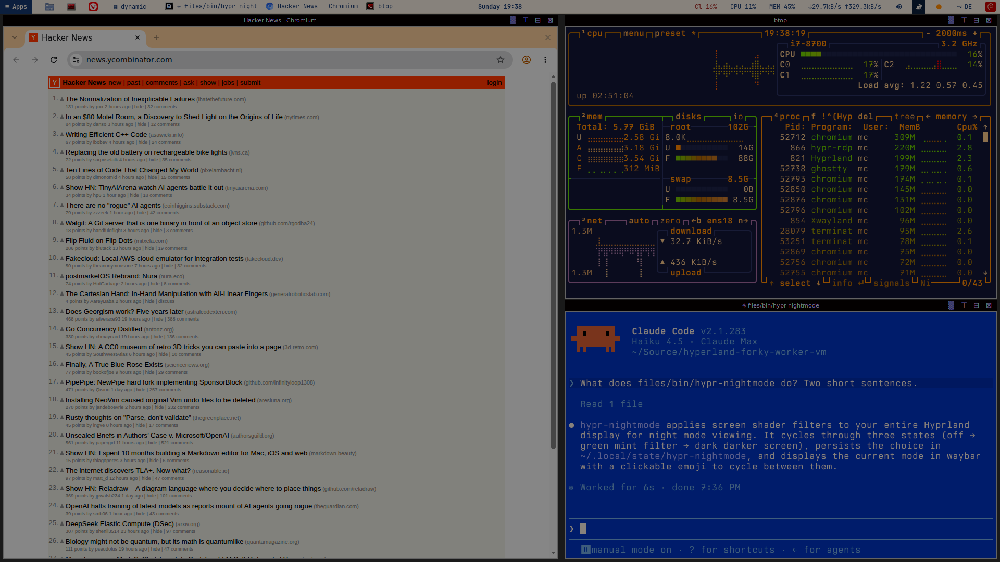

# Thin client Debian forky VM with minimal desktop

A [pyinfra](https://pyinfra.com) deployment that turns a minimal **Debian forky**
VM into a stripped-down **thin client**: a low-footprint Hyprland desktop that
you use over RDP.

* **Optimized for remote VM deployments**: Proxmox/KVM guests with no GPU,
  or with a VirGL GPU (virtio-gl, the host's iGPU) when the host has one.
  Nothing depends on graphics hardware; rendering, screen capture and the RDP
  stream are tuned for software rendering.
* **For Mac users** connecting with **Royal TS** or a similar RDP client
  (Apple keyboard layout, client-drawn cursor, lossless text).
* **For multitaskers** who want a purpose-built worker VM: terminals, AI
  agents, containers and a browser, nothing else.


It is explicitly **not** a laptop or desktop base OS: no display manager, no
GNOME/KDE, no power management, no Bluetooth, no printing. The VM boots
straight into Hyprland on tty1, and hypr-rdp serves that session.

### Gallery

| Golden-spiral layout, navy + cream themes | Terminal themes |
|---|---|
|  |  |
| **Night filter: green** (rabbit green) | **Night filter: dark** (rabbit white) |
|  |  |

## Quick start

```bash
TARGET_HOSTS=10.0.0.62 TARGET_USER=alice uv run pyinfra inventory.py deploy.py
uv run pyinfra inventory.py tasks/desktop.py       # one area only
```

[uv](https://docs.astral.sh/uv/) installs pyinfra from `pyproject.toml` /
`uv.lock` on first run; nothing else is needed on the controlling machine.
Every run is idempotent.

* `inventory.py` reads `TARGET_HOSTS` (comma-separated) and `TARGET_USER`. For
  fixed hosts, copy it to `inventory.local.py` (git-ignored), set `USER` /
  `HOSTS`, and run `uv run pyinfra inventory.local.py deploy.py`.
* The SSH user is also the desktop user (autologin, Hyprland, hypr-rdp).
* Settings for all hosts: `group_data/all.py`. Per-host overrides go into the
  host data dict, e.g. `{"ssh_user": "alice", "decorations_style": "mac"}`.

## New VM

1. **Proxmox VM**: CPU type `host`, 3+ cores, 6+ GB RAM (ballooning min = max),
   VirtIO SCSI disk with *SSD emulation* + *Discard*, display *Standard VGA*
   (or *VirGL GPU* if the host has a GPU, see below), Options → *QEMU Guest Agent* enabled.
2. **Install Debian forky** from the daily netinst ISO
   (`https://cdimage.debian.org/cdimage/daily-builds/daily/arch-latest/amd64/iso-cd/debian-testing-amd64-netinst.iso`).
   In *Software selection* tick only **SSH server** + standard utilities.
3. **Access** (once, on the VM as root; replace `alice` with your user):
   ```bash
   echo 'alice ALL=(ALL:ALL) NOPASSWD: ALL' > /etc/sudoers.d/zz-alice-nopasswd
   chmod 440 /etc/sudoers.d/zz-alice-nopasswd
   ```
   and from your machine: `ssh-copy-id alice@VM-IP`.
4. **Deploy**: `TARGET_HOSTS=VM-IP TARGET_USER=alice uv run pyinfra inventory.py deploy.py`
   (about 15 min; hypr-rdp comes as a prebuilt .deb from this repo's releases).
5. **Reboot** once (kernel options, limits), then connect with RDP as `alice`.
   The password is generated on the VM: `ssh alice@VM-IP cat ~/.config/hypr-rdp/password`.

## What it sets up

| Task | |
|---|---|
| `apt_forky` | deb822 sources for forky (+updates, security), never install recommends, full upgrade |
| `base` | purges desktop tasks, GNOME, KDE and display managers if present |
| `memory` | zram swap, reclaim sysctls, earlyoom, journald/coredump limits |
| `tuning` | network, filesystem, kernel command line, limits, modules, SSH |
| `services` | disables cups/avahi/bluetooth/ModemManager/power-profiles if present; qemu-guest-agent |
| `snitchd` | egress firewall: snitchd from a pinned release (norandom/snitch), rules in files/snitchd/rules.toml, boot revert; switches snitchd_enabled, snitchd_learn |
| `containers` | rootless podman with `docker` / `docker compose` / `docker-compose` aliases |
| `fonts` | Nerd Fonts 3.5.1: FiraCode (terminals), JetBrainsMono (UI); Fixedsys Core / Excelsior; emoji/symbol fallback (Noto Color Emoji, Symbola); font rendering |
| `desktop` | Hyprland + uwsm, hyprbars title bars, waybar, mako, fuzzel, Terminator, desktop scripts |
| `hypr_rdp` | patched hypr-rdp, config, per-host password, session helpers |
| `apps` | LibreOffice Calc + Writer (Tabbed UI, UI English/German, spelling de + en-US), Chromium + chromedriver (for MCP), Vivaldi, Sublime Text, Typora, Obsidian, Meld, rsync, rclone, git, gh, atop, Neovim, Node.js, xfce4-terminal, multitail, ripgrep, fzf (+ bat, tree), Ristretto (images), qpdfview (PDF), Rust coreutils |
| `user_tools` | uv, pnpm, Aikido Safe Chain, Neovim config (nvim-simple), rclone mounts (OneDrive), Codex + Copilot CLIs, ax, ccusage, euporie, pretty-mermaid skill |
| `shell` | grml-inspired bash, Kali-style history, xfce4-terminal paste review |
| `themes` | btop and Claude Code themes for each Terminator theme; Chromium frame colour |
| `private` | your private data (encrypted in the repo): proprietary fonts, license keys |
| `autologin` | tty1 autologin → uwsm → Hyprland |

## Tuning, and why

All values are switches in `group_data/all.py`.

**Rendering with a VirGL GPU.** With Proxmox display *VirGL GPU* (virtio-gl;
the host needs `libgl1 libegl1`), Hyprland renders through the host's GPU
(here an Intel UHD 630) and nothing else changes; it picks up the GPU by itself.
Measured on a 3-core VM at 3198x1264, Hyprland + hypr-rdp CPU (100 % = one core),
hypr-rdp at 20 fps:

| Hyprland refresh | idle | mouse moving | terminal scrolling |
|---|---|---|---|
| 20 Hz | 18 % | 31 % | 23 % |
| 30 Hz | 20 % | 30 % | 19 % |
| 60 Hz | 21 % | 32 % | 21 % |

Hyprland alone takes 13–15 % while the mouse moves, at any refresh rate
(llvmpipe: 85 % at 20 Hz, 177 % at 60 Hz). The rest is hypr-rdp capturing and
encoding (ClearCodec, on the CPU). The software-rendering limits below don't
hurt with a GPU; `rdp_refresh_hz` can go up to 60. Raising `hypr_rdp_fps`
costs encoder CPU instead.

**Rendering and RDP (no GPU).** Without a GPU, Hyprland draws everything on
the CPU (llvmpipe). With a software cursor it redraws on every pointer motion,
even with the cursor hidden, and while the screen is being shared it also
refreshes a full-screen copy each time. So:

* The RDP output runs at **20 Hz** (`rdp_refresh_hz`) and hypr-rdp sends 20
  fps (`hypr_rdp_fps`). This caps the redraws caused by mouse movement. The
  pointer itself is drawn by the RDP client, so it stays smooth; raise both to
  30 if scrolling feels choppy.
* hypr-rdp is patched to request frames at most at that rate, and less often
  while nothing changes (capture pacing), and to use **ClearCodec**: lossless,
  only the changed areas, no H.264 encoder load.
* Terminal cursors don't blink and the bar updates every 5 s. Each blink or
  bar update is a full redraw plus capture.
* No animations, shadows or blur (except glass windows) by default; `MALLOC_ARENA_MAX=2` and
  `LP_NUM_THREADS=1` (`llvmpipe_threads`) keep memory and
  renderer overhead small: one llvmpipe thread halved the CPU of scrolling
  compared with 2 or 3 threads.
* The unused Proxmox console output is switched off while an RDP client is
  connected, so only one screen is drawn.

**Memory.** Agents and workloads sometimes need all of it.

* **zram** (`zram_*`): compressed swap in RAM, **lz4**, half the RAM, with the
  disk swap behind it. lz4 costs little CPU; numeric data compresses poorly
  anyway, so zstd's better ratio isn't worth it here.
* Reclaim sysctls tuned for zram (`vm_swappiness` 100, `page-cluster=0`,
  watermarks, `dirty_bytes`): idle memory is compressed early instead of
  starving the page cache, and writeback doesn't stall in big bursts.
* **earlyoom** steps in before the kernel OOM killer and never picks the
  desktop/RDP stack (Hyprland, waybar, hypr-rdp, PipeWire, sshd).
* `/tmp` is RAM-backed and capped at 1 GB (`tmp_size`), so a build or an agent
  can't fill half the memory with temp files.
* The desktop itself uses about 350 MB: waybar/mako/fuzzel instead of a
  full shell, a plain background colour instead of a wallpaper image.

**CPU priority.** Rootless containers get CPU weight 200
(`container_cpu_weight`), the desktop and terminals 100. This only matters
when all cores are busy: then containerised jobs get about two thirds of the
CPU, while RDP and terminals stay usable.

**Kernel** (`tune_kernel_cmdline`, needs a reboot):

* `mitigations=off audit=0`: no Spectre/Meltdown mitigations and no audit
  subsystem; faster syscalls and context switches. Only for a VM that runs
  nothing untrusted.
* `cpuidle_haltpoll.force=1 cpuidle.governor=haltpoll`: idle vCPUs poll
  briefly before halting, so the VM reacts faster to RDP input (costs a
  little host CPU).
* Soft-lockup watchdog off (false alarms when the host is busy); floppy,
  pcspkr and joydev blacklisted.
* `console=tty0 console=ttyS0,115200` (`serial_console`): kernel messages
  on the serial port too, and the task enables a login on `ttyS0`.

**Serial console** (`serial_console`). The way back when the network is gone,
for example after a firewall change that denies too much (it happened:
deny-by-default cut RDP and SSH once). The guest side is this repo; the VM
also needs the device on the Proxmox host, once, with the VM stopped:
`qm set <vmid> -serial0 socket`. Then the VM's *Console* in the Proxmox UI
offers the serial terminal (xterm.js), or `qm terminal <vmid>` on the host.
A root login there needs no network and no daemon; snitchd's kill switch is
`bpftool map update pinned /sys/fs/bpf/snitch/kill key 0 0 0 0 value 1 0 0 0`.

**Network and disk.** BBR + fq and larger TCP buffers (`tune_net`) help on
WAN links; root filesystem `noatime,commit=60` (`tune_noatime`) cuts metadata
writes. The virtual disk stays on the `none` I/O scheduler: the Proxmox host
schedules the real disks.

**Limits.** 65536 open files (`nofile_*`) and 1024 inotify instances: Node,
Java, dev servers and agents run out of the defaults (1024 / 128).

## Egress firewall: snitchd

[snitchd](https://github.com/norandom/snitch) (Go + BPF LSM; replaces Little Snitch)
decides at `connect()` inside the kernel, keyed by the program's executable and the
destination. The `snitchd` task (`tasks/snitchd.py`) installs it from a pinned release,
and it runs from boot in **monitor mode**: every connection shows up in the journal with
its program and the rule that matched, nothing is denied. The local network (RFC 1918,
link-local, loopback) is allowed inside the BPF program; no rule can change that. Deny by
default runs only as a bounded trial started by hand (below), and a reboot ends a trial:
`snitchd-trial-boot.service`, enabled by the task, runs `snitchd end -at-boot` before the
daemon starts. The task never passes a mode or a duration to the daemon and never touches
the kill switch, the trial or the kept file. Verbs, fail-safes and the rules format are in
the [snitch README](https://github.com/norandom/snitch); this section is the deploy side.

**Switch and pins** (`group_data/all.py`): `snitchd_enabled = True`, `snitchd_version =
"0.3.0"` (the tag without the `v`) and `snitchd_sha256`, the digest of the `snitchd` asset
of that release. With the switch on, the task downloads
`https://github.com/norandom/snitch/releases/download/v<version>/snitchd` to a temp dir,
compares the digest and installs it as `/usr/local/sbin/snitchd` only when it matches (a
mismatch names the seen and the expected digest and replaces nothing); copies the two units
(`files/snitchd/snitchd.service`, `files/snitchd/snitchd-trial-boot.service`, verbatim
copies of the snitch repo's, one header line added) to `/etc/systemd/system/`; writes
`/etc/snitch/operator` with the desktop user's name, who may then use the API's write verbs
(trial, rule edits) from the desktop; links `/usr/sbin/snitchd`
and `/usr/local/bin/snitchd` to the binary (sudo's `secure_path` and the user's PATH have no
`/usr/local/sbin`); enables both and starts
`snitchd.service`; and restarts the daemon when the binary, a unit or the learning drop-in
changed, never for the rules file. The trial and kept files under `/var/lib/snitch` are left
alone; the daemon reads them again after a restart. The daemon's API socket is
`/run/snitch/api.sock` (readable by any local user); the schema is the snitch repo's
`examples/api.md`, and `scripts/api-check.sh` there checks it, run as the desktop user. One area only:
`TARGET_HOSTS=VM-IP TARGET_USER=alice uv run pyinfra inventory.py tasks/snitchd.py`.

**Bumping the version.** A tag `vX.Y.Z` in the snitch repo builds the release; the assets the deploy
uses are `snitchd` and `snitchd.sha256` (the Python client's files ride along). Take the digest from `snitchd.sha256` on the release
page, or download `snitchd` and run `sha256sum snitchd`; set `snitchd_version` and
`snitchd_sha256` to the new values and deploy. The daemon is back within seconds, in
monitor mode; `snitchd -version` prints the tag and `sudo snitchd status` shows it.
`tools/pin-check.py` (the daily `pins` workflow) reports a newer snitch release.

**Rules.** `files/snitchd/rules.toml` is deployed to `/etc/snitch/rules.toml` with the
switch on or off, so the file stays current. Allow rules keyed by program and destination,
translated from the Python client's BASELINE and DEV_TOOLS lists (each rule names its
source). The daemon reloads a changed file by itself (within 5 s of the change, `SIGHUP` reloads at
once), no restart; a broken file keeps the previous rules. `snitchd check -rules
files/snitchd/rules.toml` validates the file without root; CI runs it with the pinned
binary. Domain rules (github.com, pypi.org, ...) do not exist yet: the daemon decides on
addresses, names come with the DNS tap. Each one is kept in the file as a comment
`# deferred (DNS tap spec): <program> -> <domains>` next to its program, so the missing list
is visible there. In monitor mode those programs are reported by name; in a trial they are
denied beyond the rules in the file. `curl` is absent by design (wget and a bare python as a
downloader too): a general-purpose downloader gets reported and asked about, never a
blanket rule. Learned rules (next paragraph) are merged into the file by hand.

**Learning run.** `snitchd_learn = True` and deploy: a drop-in
(`/etc/systemd/system/snitchd.service.d/learn.conf`) adds `-learn`, and the daemon writes a
rule for every connection it sees to `/var/lib/snitch/learned.toml`. After a working day,
read that file as root, merge the rules you want into `files/snitchd/rules.toml` (by hand;
the learned file is never deployed), set `snitchd_learn = False` and deploy again, which
removes the drop-in and restarts the daemon. `snitchd trial` refuses while learning.

**Trial** (deny by default, bounded). Open the serial console first (above): a trial
without a rule for your own session cuts it, and the console needs no network. Then, on the
VM: `sudo snitchd trial 10m` (1 to 60 min, default 10; verb flags such as `-extend` go
before the duration) prints the deadline. `sudo snitchd status` shows daemon, mode, trial,
kept, kill switch and rules, one line each (exit 1 when the daemon is down). `sudo snitchd
end` ends the trial early; the daemon ends it at the deadline, and a reboot ends it. `sudo
snitchd keep` (only during a trial) makes enforce stay past the deadline and reboots and
prints the way back; `sudo snitchd unkeep` takes it back. From a checkout of the snitch
repo, `sudo scripts/deploy-check.sh` checks the deployed service read-only (active, version,
status, a rule event and a monitor event in the journal), and
`sudo scripts/deploy-check.sh --trial` adds a prompted two-minute trial with a trap that
ends it. The way back, as root on the serial console: the kill switch
`bpftool map update pinned /sys/fs/bpf/snitch/kill key 0 0 0 0 value 1 0 0 0` allows
everything until cleared (`value 0 0 0 0`); `scripts/fail-open.sh` in the snitch repo does
all of it; and a reboot ends a trial. If `snitchd status` or `snitchd trial` says the record
is missing a key, the daemon is an older build: `sudo systemctl restart snitchd.service`.

**Off.** `snitchd_enabled = False` and deploy: `snitchd.service` and
`snitchd-trial-boot.service` are stopped and disabled; the binary, its links, the rules and the
state files stay, so turning it on again needs no download. When a check fails, this or
`scripts/fail-open.sh` from the console is the way out; record the failure before fixing
anything.

**Kept enforce and deploys.** A host kept in enforce has no domain rule for github.com yet
(the deferred list above), so the task's own download of a new snitchd release is denied.
`sudo snitchd unkeep` (or `sudo snitchd end`, which clears a trial and a kept marker alike) first, then
deploy, then a new trial if wanted. The DNS tap spec removes the caveat.

## RDP

hypr-rdp 0.1.6 attaches to the running Hyprland session. On connect, the
console output is switched off, Hyprland's own cursor is hidden (the client
draws one; it reappears in window resize zones to show the resize arrow),
off-screen windows are pulled back, and the RDP window size survives config
reloads. On disconnect the console comes back.

Patches (`files/hypr-rdp/`): `clearcodec.patch` (`hypr_rdp_codec =
"clearcodec"`), `planar.patch` + `ironrdp-planar.patch` (legacy bitmaps, not
supported by Royal TS), `capture-pacing.patch`.

### .deb via Dagger

pyinfra installs hypr-rdp from this repository's GitHub release
(`hypr_rdp_source = "release"`, checksum in `group_data/all.py`); set it to
`"build"` to compile on the host instead. The release is built by CI: pushing
a tag `hypr-rdp-<version>` runs the Dagger module in `.dagger/`, which builds
the patched hypr-rdp in a clean Debian forky container and publishes the .deb.
Locally:

```bash
dagger call deb export --path=dist/ --allow-parent-dir-path   # dist/hypr-rdp-clearcodec_0.1.6-5_amd64.deb
```

## Desktop

| Keys | |
|---|---|
| SUPER + Return / SUPER + SHIFT + Return | Terminator / xfce4-terminal |
| SHIFT + PrtSc, then the key | one-shot Super, for keyboards without a free Super key (e.g. GPD Pocket: Windows key stays with Windows); SUPER badge in the bar while armed, Esc cancels |
| SUPER + A, ☰ Apps, right-click on the desktop | start menu (recent apps, categories ▸ apps) |
| SUPER + E | file manager (Xfe) |
| SUPER + G / title bar ▒ | glass window on / off (see-through, light milky blur) |
| SUPER + P / title bar ⊤ | stay on top on / off |
| SUPER + Y, ● in the bar | next Terminator theme (bar: right-click = previous; in Terminator: right-click → Theme) |
| SUPER + Space | launcher (search) |
| SUPER + V, clipboard button | clipboard history (right-click on the button: wipe) |
| SUPER + Escape, power button | log out, reboot, shut down |
| SUPER + W / F / SHIFT + F | close / fullscreen / maximize |
| SUPER + T | toggle floating / tiling (one window) |
| SUPER + L, ▦ in the bar | next layout mode |
| SUPER + M | show / hide minimized windows |
| SUPER + arrows, SUPER + TAB | focus / next window |
| SUPER + left / right drag | move / resize |
| SUPER + ß / ´ (+ SHIFT) | narrower / wider (shorter / taller) |

* **Glass and stay on top** (title bar ▒ and ⊤, above): the cobalt terminal is
  glass (82 % opaque, light milky blur) and pinned, so btop stays readable
  behind it. Each click shows a short on/off notification.
* **Layout modes** (`hypr-layout`): `dynamic` (floating; every app reopens
  where it was), `golden-h`, `golden-v`, `golden-spiral` (61.8 : 38.2 splits).
  Floating windows scale with the RDP window size and never end up with their
  title bar under the top bar (new, restored and moved windows are kept below it).
* **Title bars** (`hypr-deco win311|mac`): Windows 3.11 (navy, ▒ ⊤ ⊟ ⊠) or macOS
  style (red/green/blue/grey). ▒ makes a window glass: 82 % opaque with a light
  milky blur, e.g. to watch btop graphs through a terminal. Only glass windows are
  blurred; each one costs CPU while the content behind it changes (about 6 % extra
  Hyprland CPU over btop). ⊤ keeps a window above the others (Hyprland pin). Shadows: `hypr-shadow on|off` (off by default: CPU-drawn).
* **File manager**: Xfe, a small FOX-toolkit app (X11 via Xwayland) with a folder
  tree and file list like the Windows 3.11 File Manager, seeded with 3.11 colours.
* **Top bar**: app menu, launchers (Xfe, Terminator, Vivaldi), layout mode, window list, clock, CPU/MEM/net (numbers; `bar_graphs = True` adds a graph of the last 50 s via `hypr-sparkline`), volume (speaker icon: click mutes, scroll or hover slider adjusts),
  terminal theme (● in the theme's colour, click to switch), keyboard layout
  (⌨ US/DE, click to switch), power button. Drag a window to a screen edge for half / full size.

**Keyboard**: `keyboard_layout` / `keyboard_variant` / `keyboard_options`. Default:
the Apple Magic Keyboard (2015) German layout as on the Mac (`de(mac_nodeadkeys)`):
**left Option** is the Option key (`lv3:lalt_switch`): Option+L = @, Option+5/6 = [ ],
Option+7 = |, Option+Shift+7 = \, Option+8/9 = { }, Option+E = €, Option+N = ~.
Right Option is SUPER (`altwin:swap_ralt_rwin`), right Cmd works as Option too. With
no Alt key left, window switching is SUPER+Tab. The PC German layout (`nodeadkeys`,
@ = AltGr+Q) is kept commented out in `group_data/all.py`. hypr-rdp uses Hyprland's
keymap, so the mapping is the same over RDP. German and US are loaded together: switch with `kbde` / `kbus`, `setxkbmap de|us`,
`hypr-kbd de|us` or the ⌨ bar button. The choice survives reloads and reboots,
and hypr-rdp follows it without reconnecting.

## Follow the white rabbit…

The rabbit 󰤇 in the top bar is a night filter for the whole screen, browser
included (`hypr-nightmode`, a Hyprland screen shader on the GPU). Click cycles,
right-click turns it off:

| Rabbit | Mode |
|---|---|
| black | off |
| green | **green**: the mint of the computer screens in *The Matrix*, for night use |
| white | **dark**: simply dimmer, colours mostly kept |

The filters work in OKLab, a colour space built around human perception, so they
can change lightness and colour independently:

* **Lightness contrast stays** (that is what keeps text readable); only the
  brightest white is capped (green: 76 %, dark: 62 % perceived lightness), which
  takes away the glare.
* **Colours are reduced, not removed**: green keeps 35 % of the original
  colourfulness, tinted towards the film's mint (`#91F2D6`, measured from a
  still); links, warnings and images stay distinguishable. Dark keeps 80 %.
* **Blue is cut** in green mode (blue at most 80 % of green): night vision and
  melatonin react most to blue, while green reads with the least light (the eye
  is most sensitive around 555 nm).

The mode survives config reloads. The numbers are at the top of
`files/hypr/shaders/night-*.glsl`. The shader runs on the GPU; without one
(llvmpipe) it costs CPU on every frame. hypr-rdp captures the filtered screen, so
the RDP client sees it.

## Private data: fonts and licenses

Proprietary fonts and license keys can't go into a public repo, so they're kept
in `private/` (git-ignored) and committed only as the encrypted
`private.tar.age`, a bit like ansible-vault. It uses [age](https://age-encryption.org)
through the `pyrage` library, so nothing needs to be installed on the controller.

**This repo's `private.tar.age` and `private.recipients` belong to the author.**
Using this repo yourself: delete both files and either do without private data
(the deploy just skips it) or set up your own:

```bash
uv run python privdata.py keygen      # age key in ~/.config/age/keys.txt, added to private.recipients
cp -r private.example private         # then add fonts to private/fonts/, keys to private/licenses.toml
uv run python privdata.py seal        # -> private.tar.age: commit it (and private.recipients)
uv run python privdata.py open        # later: decrypt to private/ to edit, then seal again
```

* **Back up `~/.config/age/keys.txt`.** Without it `private.tar.age` can't be
  decrypted. `private.recipients` can also list SSH public keys (`ssh-ed25519
  ...`), so an unencrypted SSH key on another controller works too;
  `PRIVATE_IDENTITY=path1:path2` picks the identity files.
* The deploy uses `private/` when it exists, otherwise it decrypts
  `private.tar.age` in memory. Nothing decrypted is written to the repo.
* **Fonts** (`private/fonts/`) are installed to `/usr/local/share/fonts/private`.
* **Licenses** (`private/licenses.toml`, see `private.example/`): installed as
  `~/.local/share/licenses/licenses.toml` (mode 600). Sublime Text's license
  file is written where Sublime reads it. For apps that are activated in their
  own UI (Typora: Help → My License), use **Licenses** in the app menu or
  `hypr-licenses [app] [field]`. It copies the value to the clipboard, marked
  sensitive.

## Shell and tools

* **grml-inspired bash** (grml's own config is zsh-only): prompt with git
  branch and exit code, directory stack (`d`, `cd -2`), `..`, autocd, grml
  aliases and helpers (`mkcd cdt bk sll`), bash-completion.
* **Kali-style history**: 100k entries, timestamps, shared between
  terminals, prefix + Up/Down search.
* **xfce4-terminal**: pasting text with a line break opens an editable review
  dialog first.
* **Containers**: `docker`, `docker compose` and `docker-compose` run
  rootless podman without a daemon.
* **Terminator themes**: `default` (cobalt), `navy`, `fixedsys` (amber on navy,
  Berkeley Mono from the private data; the default monospace without it), `cream`
  (light: navy on cream), `petrol` (orange on petrol `#002b36`, blue block cursor,
  Fixedsys Core). New themes: add a Terminator profile and its tab colours, then
  `python3 tools/themegen.py` writes the Ghostty and foot themes; Claude Code, btop and
  Sublime Text have one file per theme in `files/themes/` and `files/sublime/`. The ● bar button (click next, right-click previous), SUPER+Y,
  `hypr-termtheme <name>|next|prev` or right-click → Theme switches all open
  terminals; new ones (SUPER+Return, app menu) use the last choice. Tabs are a
  slim tmux-style line at the bottom; tab titles show just the directory. The
  tab bar takes the theme's font (Fixedsys Core for `fixedsys`) and colours.
  Terminal apps switch along: Claude Code (`~/.claude/themes`, live) and btop
  (reloads its config) and Sublime Text (colour scheme + the theme's font, e.g.
  Fixedsys Core) get a matching theme; Neovim starts with Berg light for
  `cream` and Berg dark otherwise.

  
* **CLI tools**: ripgrep, fd, fzf (+ bat, tree for previews), multitail, aria2, btop,
  atop, lazygit, Neovim with [nvim-simple](https://github.com/norandom/nvim-simple)
  (CUA keys, F10 menu bar, Berg theme; pinned in `nvim_simple_commit`). An old
  LazyVim config is moved to `~/.config/nvim.lazyvim`.
* **Rust coreutils**: uutils (`rust-coreutils`) comes first in `PATH` for your
  shells and the Hyprland session (`uutils_coreutils`); system services and root
  keep GNU coreutils.
* **Editors and apps**: Sublime Text (`subl`), Typora, Obsidian (pinned .deb,
  checksum verified), Vivaldi. Sublime, Typora and Vivaldi come from the vendors'
  apt repositories (deb822 sources pinned to their keys).
* **Client role** (`client_hosts`, only the hosts listed; removed elsewhere): tools
  for client work, pinned .debs with checksums. PdfCraft, DesignCraft,
  GridCraft (Excel-style) and LightCraft (Lightroom-style) (ArtCraft, Apache-2.0), Quarto, Positron (Posit's data science IDE) and VS Code,
  about 4 GB together. Quarto works with Python only (no R): code cells run in a uv
  env with pinned Jupyter packages (`quarto_python`, `QUARTO_PYTHON` set for the shell
  and the session), PDF output through TinyTeX (`~/.TinyTeX`). VS Code's offer to add Microsoft's apt repo is declined; both
  editors run with telemetry and self-update off and native title bars (the
  Hyprland ones, in the host colour). Their colour theme follows the terminal
  profile like Sublime's (`hypr-termtheme`): a local extension generated from the
  Sublime schemes and terminal palettes (`tools/vscodetheme.py` →
  `files/vscode/debian-hypr-themes`).
* **Pinned updates**: every download is pinned (version + sha256 in `group_data/all.py`).
  The update process:
  1. *Detect*: the daily `pins` workflow runs `tools/pin-check.py` against upstream and keeps
     an issue "Pinned dependency updates" open while something is outdated.
  2. *Bump*: it also runs `tools/pin-bump.py`, which sets the new version and the sha256
     upstream publishes (GitHub's asset digest, VS Code's and Posit's metadata), and pushes
     that to the branch `pin-bump`; the issue links its diff. Locally the same:
     `tools/pin-bump.py [name ...]` (`--dry-run` to look first). Pins it can't bump safely
     (hypr-rdp, Ghostty, Nerd Fonts, kubectl, Helm, ax) are listed as MANUAL.
  3. *Apply*: merge (or commit the local bump), deploy, check the apps; the next run closes
     the issue and deletes the branch.
* **Files and sync**: rsync, Meld (graphical diff and merge for files and
  folders, like WinDiff), rclone (GitHub release, pinned).
* **OneDrive (personal)** via rclone: `rclone_mounts` maps a remote to a folder
  in your home (`onedrive` → `~/OneDrive`), mounted by the user service
  `rclone-onedrive` (FUSE, full VFS cache up to 2 GB). Set up the remote once,
  in a terminal in the RDP session (the login opens in the browser there):

  ```bash
  rclone config        # n) new remote, name: onedrive, storage: onedrive,
                       # defaults, "Use web browser to authenticate": yes,
                       # then "OneDrive Personal or Business" -> the personal drive
  systemctl --user restart rclone-onedrive
  ```

  Until the remote exists the service is skipped. The token lives in
  `~/.config/rclone/rclone.conf` on the host (rclone refreshes it); it isn't
  part of the private data.
* **Viewers**: Ristretto (images), qpdfview (PDF: tabs, annotations), Xfe (files).
* **Kubernetes**: `kubectl` (alias `k`) and `helm` from the upstream releases (pinned,
  checksum verified; Debian's kubectl is 4 minor versions behind, and kubectl should be
  within one minor version of the cluster), with bash completion. TUIs:
  [ktop](https://github.com/vladimirvivien/ktop), a btop for the cluster (live node and pod
  CPU / memory against requests and limits; metrics-server or Prometheus, works without
  either), and [k9s](https://k9scli.io) to browse and act (`:pods`, `l` logs, `s` shell,
  `e` edit, also AX's `Task` resources).
  [ax](https://github.com/google/ax) (`ax_version`) is Google's agentic orchestration
  CLI: it runs AI agent tasks in sandboxes on a cluster that has
  [Agent Substrate](https://github.com/agent-substrate/substrate) installed (`ax apply -f
  task.yaml`, `ax watch task …`, `ax ssh …`), next to kubectl rather than instead of it.
  It has no release binaries yet, so it is built with Go at the pinned tag (Go fetches
  the toolchain version the tag needs).
* **Object storage**: `rc`, the [RustFS](https://rustfs.com) CLI (S3 objects and RustFS
  admin; also MinIO / AWS S3): `rc alias set myrustfs https://host:9000 ACCESS SECRET`,
  then `rc ls myrustfs`.
* **More terminals**: Ghostty (Debian forky build from
  [mkasberg/ghostty-ubuntu](https://github.com/mkasberg/ghostty-ubuntu), pinned) and foot.
  Both follow the Terminator theme: `hypr-termtheme` copies the matching theme
  file (colours + font, generated from the Terminator profiles) and running Ghostty
  windows reload it live; foot picks it up for new windows. Ghostty keeps its Linux
  keybindings (Ctrl+Shift+T tab, Ctrl+Shift+O / E splits); Super belongs to Hyprland.
  Its tab bar is a slim flat line in the theme's colours (as Terminator's tabs),
  instead of the tall Adwaita toolbar.
* **Network control**: Little Snitch is retired; [snitchd](https://github.com/norandom/snitch)
  (Go, eBPF egress firewall) watches egress from boot in monitor mode, switch `snitchd_enabled`
  (section "Egress firewall: snitchd").
* **Away lock** (`hypr-away`): 10 minutes without an RDP session, and sudo asks for the
  password and ptrace is restricted; it unlocks as soon as you reconnect. Details:
  [docs/away-lock.md](docs/away-lock.md).
* **Which VM am I on?** Title bars and the active window border take a colour per host
  (`tools/hostcolor.py`, set at deploy from the hostname): same lightness for every host, white
  text at 6.4–7.4:1 contrast. List the VMs in `fleet_hosts` (`group_data/all.py`): the position
  sets the hue, so the first 8 are clearly apart (debb: petrol #0b647e). Unlisted hosts get a
  hue from a hash of the name; `decor_colors` overrides one by hand.
  `python3 tools/hostcolor.py debb vm2 …` shows the colours and warns when two are too close.
* **Console lock**: the Proxmox / SPICE console needs your password (hyprlock), RDP logs in by
  itself. RDP gone -> the session locks before the console shows it; RDP back -> console
  display, keyboard and mouse off, then it unlocks. One session, no second login.
* **Disk space** (`dev-disk-reclaim`, nightly at 03:30 via `dev-disk-reclaim.timer`):
  removes regenerable caches so the disk stays free for dev work: stopped containers,
  superseded (dangling) images, unused volumes and the build cache (rootless Podman), the
  npm / pip / Go caches, `uv cache prune`, cargo build output in `~/.cache`, agent/test
  junk in `/tmp`, everything older than `--keep-days` (3). `--dry-run` only shows what
  would go; `--sudo` adds journald vacuum, apt autoremove + clean; `--images` also
  prunes unused tagged images, `--keep-volumes` keeps volumes. Codex, Claude Code and
  the container store are only watched (warning above 3 GiB). apt does not keep
  downloaded packages, the deploy deletes its `.deb` files after installing, and the
  `ax` build drops Go's caches (several GB) right away.
* **Clipboard history** ([cliphist](https://github.com/sentriz/cliphist), `hypr-cliphist`):
  SUPER+V or the clipboard button in the bar picks an older entry in fuzzel; right-click
  on the button wipes it now. Built for a VM that runs for weeks: the history lives in RAM
  (`$XDG_RUNTIME_DIR`), holds at most 200 entries and is wiped every night at 01:00
  (`hypr-cliphist-wipe.timer`, catches up after downtime), together with the current
  clipboard. Not recorded: copies marked sensitive (password managers, `hypr-licenses`)
  and anything copied while Bitwarden has the focus. Copies coming in over RDP carry no
  such mark, so a password copied on the client stays in the history until the next wipe.
* **Bitwarden**: the desktop app and `bw`, both pinned from Bitwarden's GitHub releases
  (checksum verified). The CLI is deliberately not installed from npm: `@bitwarden/cli`
  2026.4.0 there was backdoored for 93 minutes in April 2026 (a compromised CI action).
* **GitHub**: `gh` (GitHub's apt repository) and the [Copilot CLI](https://docs.github.com/en/copilot/how-tos/copilot-cli)
  (`copilot`, npm global; `gh copilot` runs the same one). Log in once with `gh auth login`
  (needs a Copilot subscription for Copilot): shells export `COPILOT_GITHUB_TOKEN` from
  `gh auth token`, so Copilot uses gh's login (there is no keychain on this desktop for a
  login of its own); `gh auth logout` ends both.
* **AI quota in the bar**: `Cl 90%  Co 60%` = weekly quota left for Claude and Codex
  (green / yellow / red; tooltip: every window and its reset time; click: refresh).
  Claude via Anthropic's OAuth usage endpoint with Claude Code's own login, Codex via
  `codex app-server`; ported from [shiftynick/omarchy-agent-quota-bar](https://github.com/shiftynick/omarchy-agent-quota-bar)
  (an Omarchy shell widget). Codex CLI is installed (npm); run `codex login` once.
* **Classic X11 tools in the Windows 3.11 look**: Xfe's own Xfw (editor), Xfi
  (images), Xfa (archives), Xfp (packages); NEdit (Motif editor with syntax
  highlighting, text in Fixedsys; Latin-1 only, UTF-8 shows as garbage) and xpdf,
  coloured through `~/.Xdefaults` (Xwayland has no xrdb). NEdit draws its text with
  core X fonts, so `hypr-xfonts` puts Fixedsys on Xwayland's font path at session start.
  These programs offer copied text only as X11 `STRING` (Latin-1), which hypr-rdp and many
  Wayland apps ignore; the user service `hypr-clip-bridge` re-publishes such copies as
  UTF-8 text, so they reach the RDP client (upstream fix: MuNeNiCK/hypr-rdp#107).
* **Mainframes**: x3270 (menu: System → IBM 3270 Terminal) with the 3270 keypad
  built in (PF1-24, PA1-3, Clear, Enter, Attn, SysReq, ...), e.g. for z/OS, z/VM or
  Linux on Z consoles; c3270 is the same in a terminal. The dynamic layout leaves
  x3270's size alone (it sizes itself from the 3270 screen).
* **App menu** (`hypr-appmenu`): a Windows 95-style start menu, Wayland-native
  (GTK3 on a layer-shell overlay). The last three applications started from it on
  top, then the categories: hovering one opens its applications beside it, a click
  starts one, a click anywhere else (the Apps button too) or Escape closes the
  menu; arrow keys work. *Run…* opens the fuzzel search (also SUPER+SPACE),
  *Shut down…* has log out / reboot / shut down. Windows 3.1 icons, fetched at
  deploy time from [mRB0/many-windows-3.1-icons-in-png-format](https://github.com/mRB0/many-windows-3.1-icons-in-png-format)
  at a pinned commit (`win31_icons_commit`; Microsoft's icons, so not stored in
  this repo; `None` = the apps' own icons); the selection bar is the host colour.
  All text editors (Sublime Text, Typora, NEdit, Xfw, Neovim, Vim) are grouped
  under *Editors*.
* **TUIs**: `glow` (Markdown), `posting` (HTTP/API client), `trip` (trippy:
  traceroute + ping), `gdu` (disk usage), `podman-tui` (containers; uses the
  socket-activated user `podman.socket`), `zellij` (terminal workspaces), `upmd`
  (run tasks and workflows from Markdown code blocks), `euporie-notebook`
  (Jupyter notebooks in the terminal, with a Python kernel). podman-tui, zellij
  and upmd come from their GitHub releases (pinned, checksum verified,
  `release_tools`).
* **AI agents**: `ccusage` (Claude Code token usage and cost) and the Claude Code
  skill *pretty-mermaid* (Mermaid diagrams as SVG or terminal ASCII).
* **Supply chain**: Aikido Safe Chain wraps npm, npx, pnpm, pip, uv and uvx
  and blocks packages younger than 48 hours.

## Software

The projects this setup installs or builds on, with their home pages.

**Desktop and RDP**
- [Hyprland](https://hyprland.org) (compositor) with [hyprbars](https://github.com/hyprwm/hyprland-plugins) (title bars), started by [uwsm](https://github.com/Vladimir-csp/uwsm)
- [hypr-rdp](https://github.com/MuNeNICK/hypr-rdp) (RDP server, patched here) on [IronRDP](https://github.com/Devolutions/IronRDP)
- [Waybar](https://github.com/Alexays/Waybar) (top bar), [mako](https://github.com/emersion/mako) (notifications), [fuzzel](https://codeberg.org/dnkl/fuzzel) (launcher, power menu), [gtk-layer-shell](https://github.com/wmww/gtk-layer-shell) (start menu)
- [PipeWire](https://pipewire.org) (audio, redirected to the RDP client)
- [Royal TS](https://www.royalapps.com) (RDP client used on the Mac); ideas from [Omarchy](https://omarchy.org)

**Terminals and shell**
- [Terminator](https://gnome-terminator.org), [Ghostty](https://ghostty.org), [foot](https://codeberg.org/dnkl/foot), [xfce4-terminal](https://docs.xfce.org/apps/xfce4-terminal/start), [zellij](https://zellij.dev)
- [Neovim](https://neovim.io) with [nvim-simple](https://github.com/norandom/nvim-simple)
- [uutils coreutils](https://uutils.github.io) (Rust coreutils)
- [ripgrep](https://github.com/BurntSushi/ripgrep), [fd](https://github.com/sharkdp/fd), [fzf](https://github.com/junegunn/fzf), [bat](https://github.com/sharkdp/bat), [lazygit](https://github.com/jesseduffield/lazygit), [multitail](https://www.vanheusden.com/multitail/), [aria2](https://aria2.github.io), [GitHub CLI](https://cli.github.com)
- [btop](https://github.com/aristocratos/btop), [atop](https://www.atoptool.nl), [gdu](https://github.com/dundee/gdu), [trippy](https://trippy.rs), [glow](https://github.com/charmbracelet/glow), [posting](https://posting.sh), [upmd](https://github.com/rezigned/upmd), [euporie](https://github.com/joouha/euporie)
- [x3270 / c3270](https://x3270.bgp.nu) (IBM 3270 terminal)

**Applications**
- [Sublime Text](https://www.sublimetext.com), [Typora](https://typora.io), [Obsidian](https://obsidian.md), [NEdit](https://sourceforge.net/projects/nedit/), [Xfe](https://sourceforge.net/projects/xfe/) (file manager, with Xfw, Xfi, Xfa, Xfp)
- [LibreOffice](https://www.libreoffice.org) (Calc, Writer), [Meld](https://meldmerge.org), [xpdf](http://www.xpdfreader.com), [qpdfview](https://launchpad.net/qpdfview), [Ristretto](https://docs.xfce.org/apps/ristretto/start)
- [Vivaldi](https://vivaldi.com), [Chromium](https://www.chromium.org)
- Client role: [Quarto](https://quarto.org), [Positron](https://positron.posit.co), [VS Code](https://code.visualstudio.com), [PdfCraft, DesignCraft, GridCraft and LightCraft](https://getartcraft.com/apps)
- [rclone](https://rclone.org) (OneDrive), [rsync](https://rsync.samba.org), [rc](https://github.com/rustfs/cli) (RustFS)

**Containers, security, agents**
- [Podman](https://podman.io) with [podman-tui](https://github.com/containers/podman-tui)
- [kubectl](https://kubernetes.io/docs/reference/kubectl/), [Helm](https://helm.sh), [k9s](https://k9scli.io), [ktop](https://github.com/vladimirvivien/ktop), [ax](https://github.com/google/ax), [Go](https://go.dev)
- [Aikido Safe Chain](https://github.com/AikidoSec/safe-chain), [earlyoom](https://github.com/rfjakob/earlyoom)
- [Bitwarden](https://bitwarden.com) (desktop, CLI), [cliphist](https://github.com/sentriz/cliphist)
- [Claude Code](https://claude.com/claude-code), [Codex CLI](https://github.com/openai/codex), [GitHub Copilot CLI](https://github.com/github/copilot-cli), [ccusage](https://github.com/ryoppippi/ccusage), [pretty-mermaid](https://github.com/imxv/pretty-mermaid-skills)

**Fonts**
- [Berkeley Mono](https://usgraphics.com/products/berkeley-mono) (commercial; private data only)
- [Nerd Fonts](https://www.nerdfonts.com): [JetBrains Mono](https://www.jetbrains.com/lp/mono/), [Fira Code](https://github.com/tonsky/FiraCode)
- [Fixedsys Core](https://github.com/delinx/Fixedsys-Core), [Fixedsys Excelsior](https://github.com/kika/fixedsys)
- [Noto Color Emoji](https://github.com/googlefonts/noto-emoji), [Symbola](https://dn-works.com/ufas/)

**Deployment**
- [pyinfra](https://pyinfra.com), [uv](https://docs.astral.sh/uv/), [Dagger](https://dagger.io) (hypr-rdp .deb in CI)
- [age](https://age-encryption.org) via [pyrage](https://github.com/woodruffw/pyrage) (private data)
